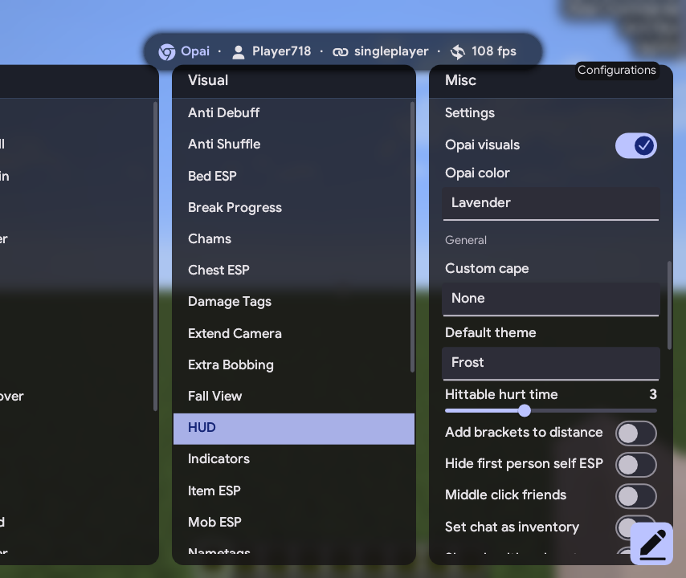

# Raven B4 enhanced with Opai visuals

Raven B4 enhanced with Opai visuals, featuring a redesigned ClickGUI, Dynamic Island, ArrayList, and Target HUD.

<div align="center">
  
</div>

## Original projects

- **Raven B4 / Open B4**: the base client. Raven B4 was originally created by **Chef**; the original Open B4 recovery credits are retained below.
- **[Samsara](https://github.com/ZiLin466/Samsara)** by **[ZiLin466](https://github.com/ZiLin466)**: the original project used as the reference for this Opai visual adaptation, including its GUI, Dynamic Island, ArrayList, Target HUD, fonts, palettes, and animation behavior.

See the [source and license notes](OpenB4/src/main/resources/assets/raven/opai/licenses/THIRD-PARTY.txt) for attribution and the pinned reference revision.

## Original Open B4 interface

<div align="center">
  
</div>

## Changes

- Removed all API calls and backend references
- Spoof UID #1

## Building

```powershell
cd OpenB4
.\gradlew.bat build
```

## Decrypting Scripts - u20

Raven's protected scripts carry two recovered layers:

1. **AES-128/ECB** — key `K8ai@rUb^mj7X91P`, applied to the Base64 in a `decrypt - "<base64>"` line.
2. **Hex/XOR chain** — a 16-byte key table and a shift constant of `73`. The first two hex digits
   seed the chain and the rest are the data bytes.

The plaintext keeps a 32-character trailer, and the client stamps the formula it contains with the
user's UID: `size * 0.05506` becomes `size * 0.05` + the UID.

## Credits

- Sande: Finding an undetected way to dump and providing the dump
- Abusez: Deobfuscating/Recovering
- Mega: Deobfuscating/Recovering
- Chef: Making Raven B4
- [ZiLin466](https://github.com/ZiLin466): [Samsara](https://github.com/ZiLin466/Samsara), the reference project for the Opai visuals

## Opai visuals

Enable **Settings → Opai visuals** to switch the complete visual style. Use **Opai color** to choose Lavender or Light Pink. See [OPAI.md](OPAI.md) for the NanoVG backend, HUD editor, build instructions, and verification commands.
